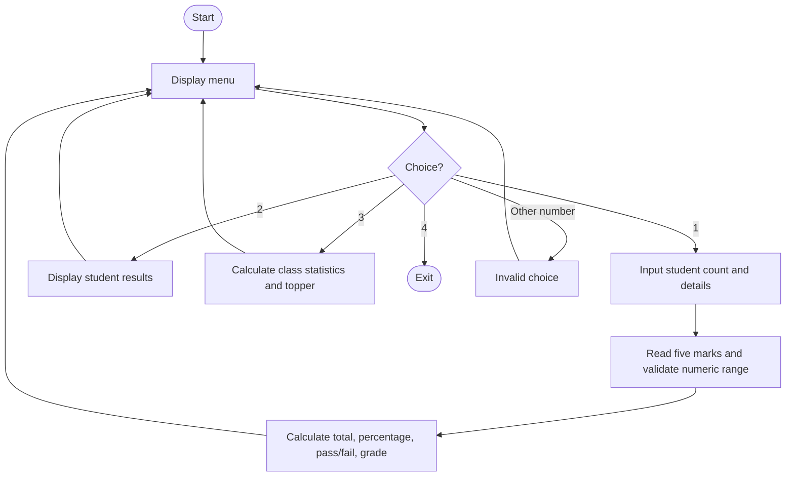

# Student Result and Grade Analyzer

**Mini Hackathon — C Programming Lab | Problem 3**

## Team Details

| Field | Details |
|---|---|
| Batch | 42 |
| Team number | 1 |
| Member 1 | Sahil Baruwa |
| Member 2 | Aryan Rathore |
| Member 3 | Manjeet Yadav |

## Problem Statement

Develop a result-processing program that calculates student performance across multiple subjects. Accept marks for five subjects for multiple students, calculate total marks, percentage and grade, identify pass/fail status using a specified minimum mark in each subject, and display the class topper and class average.

**Expected output:** Student-wise result summary and class performance report.

## Objectives and Features

- Store roll number, name, and five subject marks for up to 100 students.
- Calculate total marks out of 500 and percentage.
- Assign grades A+, A, B, C, D, E or F.
- Mark a student FAIL if any subject mark is below 35.
- Display each student's result and a class report.
- Calculate the number of passing and failing students, class average, pass percentage, and class topper.
- Provide a menu with four options: input, student results, class report, and exit.
- Reject numeric subject marks outside the range 0–100 and student counts outside 1–100.

## Grading Rules

| Condition | Grade |
|---|---|
| Any subject below 35 | F |
| All subjects passed; percentage >= 90 | A+ |
| 80 to below 90 | A |
| 70 to below 80 | B |
| 60 to below 70 | C |
| 50 to below 60 | D |
| Below 50, with all subjects passed | E |

Each subject is out of 100. The topper is the highest-scoring **passing** student. In a tie, the student entered first is selected. The class average includes both passing and failing students.

## Algorithm / Pseudocode

1. Start the program and display the menu.
2. If option 1 is selected, read the number of students and verify it is between 1 and 100.
3. For each student, read roll number, name, and five subject marks.
4. For each subject, repeat entry if a numeric mark is outside 0–100; add the mark to the total and mark the student as failing if it is below 35.
5. Calculate percentage = total / 5.0.
6. Assign F if any subject was failed; otherwise assign the grade according to the percentage.
7. If option 2 is selected, display all students' roll numbers, names, totals, percentages, grades and pass/fail status.
8. If option 3 is selected, calculate and display the number passed and failed, class average, pass percentage, and highest-scoring passing student.
9. Repeat the menu until option 4 is selected, then exit.

## Flowchart



## C Programming Concepts Used

- `#include <stdio.h>` for console input/output.
- `struct Student` to group student data.
- Arrays (`s[100]`, `marks[5]`) and character arrays for names and grades.
- Functions: `inputStudents()`, `displayResults()`, `classReport()`, `main()`.
- `for` loops for students and subjects; `do-while` for mark validation and the menu.
- `if-else` for pass/fail and grading; `switch-case` for menu choices.
- Arithmetic and relational operators; formatted `printf()` and `scanf()`.

## Compile and Run

Requirements: GCC or another C compiler.

```bash
gcc -std=c11 -Wall -Wextra student_result_analyzer.c -o student_result_analyzer
```

On Windows, run `student_result_analyzer.exe`; on Linux/macOS, run `./student_result_analyzer`.

Choose **1** to enter student data, **2** to view results, **3** for the class report, and **4** to exit.

## Sample Test Cases — Expected and Actual Outputs

The following tests were run with the exact submitted C source code using numeric inputs.

| Test | Input summary | Expected | Actual |
|---|---|---|---|
| Normal pass | 85, 90, 75, 80, 70 | 400/500; 80.00%; A; PASS | 400/500; 80.00%; A; PASS |
| Exactly passing | 35, 35, 35, 35, 35 | 175/500; 35.00%; E; PASS | 175/500; 35.00%; E; PASS |
| Fail one subject | 90, 90, 90, 90, 30 | 390/500; 78.00%; F; FAIL | 390/500; 78.00%; F; FAIL |
| Full marks | 100, 100, 100, 100, 100 | 500/500; 100.00%; A+; PASS | 500/500; 100.00%; A+; PASS |
| Invalid numeric mark | 110, then 80 for first subject | Reject 110, accept 80 | `Invalid marks! Enter 0 to 100.`; then accepts 80 |
| Class report | Asha: 450, Ravi: 350, Neha: 390 (Neha fails one subject) | 3 students; 2 pass; 1 fail; average 79.33%; topper Asha | 3 students; 2 pass; 1 fail; average 79.33%; topper Asha |
| Invalid student count | 101 | Reject count | `Invalid number of students!` |

### Example class report

```text
========== CLASS REPORT ==========

Total Students: 3
Passed Students: 2
Failed Students: 1
Class Average: 79.33%
Pass Percentage: 66.67%

Class Topper: Asha
Roll Number: 101
Total Marks: 450/500
Percentage: 90.00%
```

## Known Limitations

- The source code assumes numeric input for student counts, roll numbers, and marks. Entering letters where a number is expected may cause incorrect behavior or a repeated input loop.
- Duplicate roll numbers are not checked.
- Empty names are not explicitly rejected.
- Student details are held in memory and are not saved to a file.
- Entering new student data replaces the previous set.

## Conclusion

The Student Result and Grade Analyzer demonstrates structures, arrays, loops, conditions, functions, and menu-driven programming in C to produce individual student results and class-level statistics.
